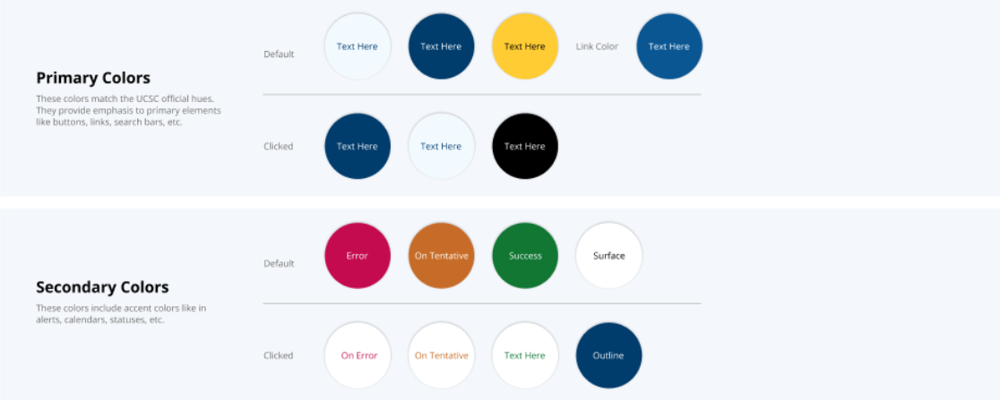
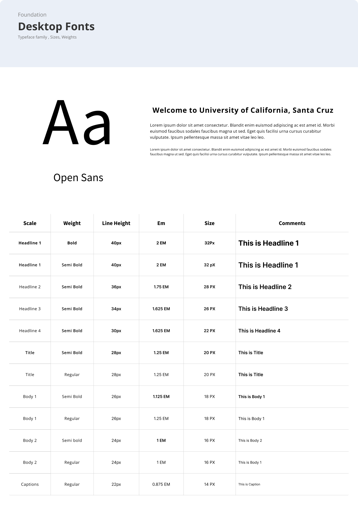
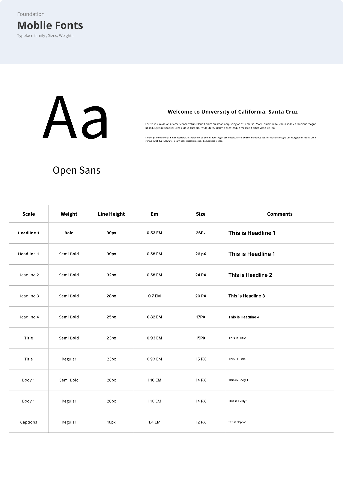
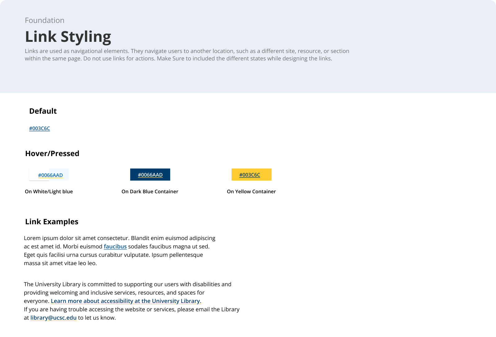
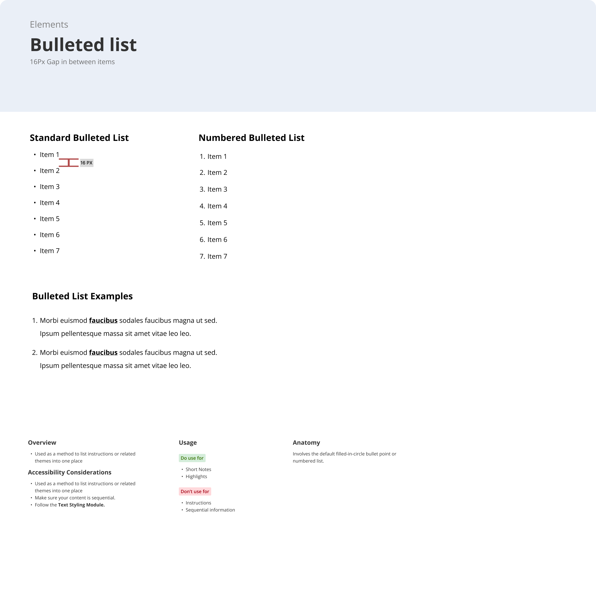

# Design System

## Components

Select a component below to view its docs.

| Component | Docs |
| --- | --- |
| Accordian | [View docs](./accordian/) |
| Button | [View docs](./button/) |
| Cards | [View docs](./card/) |
| Dropdown | [View docs](./dropdown/) |
| Label | [View docs](./label/) |
| Pagination | [View docs](./pagination/) |
| Search Bar | [View docs](./search-bar/) |
| Side Tabbed Box | [View docs](./side-tab-box/) |
| Table | [View docs](./table/) |

## Foundations

### Colors

#### Primary colors

| Use             | State       | Background                                     | Suggested text                                 |
| --------------- | -------     | ---------------------------------------------- | ---------------------------------------------- |
| Light blue      | Default     |  `#F3FAFF` |  `#003C6C` |
| Light blue      | **Clicked** |  `#003C6C` |  `#FFFFFF` |
| Dark blue       | Default     |  `#003C6C` |  `#FFFFFF` |
| Dark blue       | **Clicked** |  `#F3FAFF` |  `#003C6C` |
| Yellow          | Default     |  `#FFCC33` |  `#000000` |
| Yellow          | **Clicked** |  `#000000` |  `#FFFFFF` |
| Link            | Default     |  `#0A5692` |  `#FFFFFF` |

#### Secondary colors

| Use             | State       | Background                                     | Suggested text                                 |
| --------------- | -------     | ---------------------------------------------- | ---------------------------------------------- |
| Error           | Default     |  `#C50B50` |  `#FFFFFF` |
| Error           | **Clicked** |  `#FFFFFF` |  `#C50B50` |
| Tentative       | Default     |  `#C76C28` |  `#FFFFFF` |
| Tentative       | **Clicked** |  `#FFFFFF` |  `#C76C28` |
| Success         | Default     |  `#117733` |  `#FFFFFF` |
| Success         | **Clicked** |  `#FFFFFF` |  `#117733` |
| Surface         | Default     |  `#FFFFFF` |  `#000000` |
| Surface outline | **Clicked** |  `#003C6C` |  `#FFFFFF` |

### Typography

### Link Styling

### Lists

