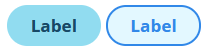

# Label

Rounded, selectable labels. Labels use `aria-pressed` to expose their selected state.

## Preview

## Usage

Copy the style and markup from [label.html](./label.html). The length scales with content and sizing can be adjusted broadly with scale or more precisly with the other css variables.
